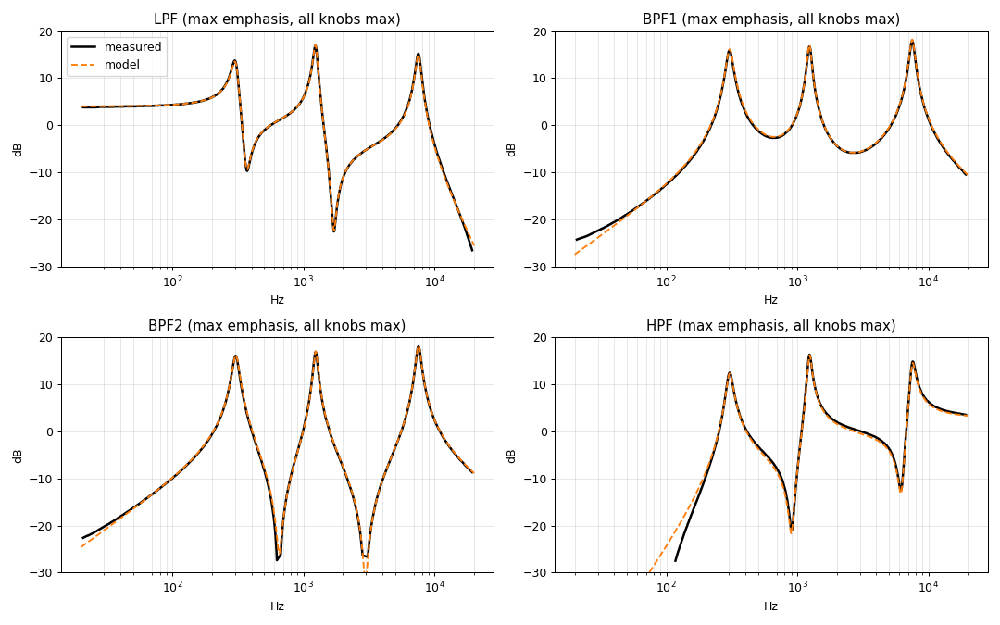

# Resonator – stereo AU / VST3 plugin

A software model of the JSISYNTH **Resonator** 3-channel resonant filter (Polymoog-style),
built from the REV-A schematic and nine frequency-response captures.

## Building (macOS, for Ableton Live)

Requirements: Xcode command-line tools (`xcode-select --install`) and CMake (`brew install cmake`).

```bash
cd ResonatorAU
cmake -B build -DCMAKE_BUILD_TYPE=Release
cmake --build build --config Release --target Resonator_AU Resonator_VST3
```

The first configure downloads JUCE 8.0.15 (needs git + internet). On macOS the build
copies the plugins to `~/Library/Audio/Plug-Ins/Components/Resonator.component` (AU) and
`~/Library/Audio/Plug-Ins/VST3/Resonator.vst3`.

Then:
1. Validate (optional): `auval -v aufx Rsn1 Rdiy`
2. In Live: Preferences → Plug-ins → enable **Use Audio Units**, then **Rescan**.
   If it doesn't appear: `killall -9 AudioComponentRegistrar`, restart Live.
3. Find it under Plug-ins → Audio Units → ResonatorDIY → Resonator.

No local Mac toolchain? Push this folder to a GitHub repo and run the **Build Resonator**
workflow (`.github/workflows/build.yml`); it produces an ad-hoc-signed zip. If macOS blocks
a downloaded copy: `xattr -dr com.apple.quarantine Resonator.component`.

## Controls

| Control | What it does |
|---|---|
| Mode | LPF / BPF 1 (mid band inverted, smooth) / BPF 2 (all in phase, notches between bands) / HPF |
| Low / Mid / High | Centre frequency of each band. Ranges: 61-304 Hz, 328-1236 Hz, 1.5-7.5 kHz |
| Emphasis | Resonance (Q) of all three bands |
| Freq law | *Analog (pot)*: reciprocal taper of a linear pot + fixed resistor. *Exponential*: even octaves per turn |
| Quality | Eco 1x, Standard 2x (default), High 4x oversampling (see accuracy) |
| Mix / Output / Bypass | Latency-compensated dry/wet, output trim, host bypass |

Level is faithful to the hardware measurements (LPF passband sits ~+3.8 dB); use Output to trim.

## How the model works

Each channel (L and R processed independently) is three 2-pole state-variable filters (ZDF/TPT)
whose LP, BP (peak = Q) and HP outputs are summed with fitted weights depending on the mode.
Fitting the captures showed that the BPF 1 curve is the *alternating-sign* sum (+LF, -MF, +HF),
matching the schematic's separate `MF_BPF` / `MF_NEG_BPF` nets. Parameters were fit by least squares
(`Tools/`): 0.67 dB RMS across the four mode captures; Emphasis maps log-linearly to Q using the
0/50/100 % curves (Q rises about 16x, with per-band differences).



### Accuracy of the real plugin (measured with the headless test)

| Quality | max dev. 20 Hz-10 kHz | RMS vs captures |
|---|---|---|
| Eco 1x @44.1k | 2-6 dB (bilinear warping) | 1.4-3.7 dB |
| Standard 2x | ≤ 1.2 dB | 0.6-1.2 dB |
| High 4x | ≤ 0.3 dB | 0.2-1.2 dB |

Oversampling uses linear-phase FIR half-bands; latency (49 / 60 samples) is reported to the host
and the dry path is delayed to match (verified sample-exact).

## Tests

* `dsp_test` - plain C++ impulse-response dump for the DSP core.
* `ResonatorTest` - instantiates the real processor: impulse responses, dry/wet alignment, and a
  randomised automation stress test (`cmake --build build --target ResonatorTest`).
* `Tools/*.py` - digitising, fitting and verification scripts.

## Assumptions / not modelled

* Only the *magnitude* curves were available; phase follows from the ideal SVF structure.
* The Emphasis captures are assumed to be at 0/50/100 % of the knob.
* The Low/Mid/High knob taper between the measured endpoints is inferred from the schematic (2k4 fixed
  resistors + 10k linear pots), not measured; use *Exponential* if you prefer.
* Analog non-linearities (NE5532/MC1458 clipping, the CD4016 switch resistance, noise) are not modelled; the filter is linear.
* Captures 04-06 (if you have them) would show other panel functions that this plugin doesn't expose.
